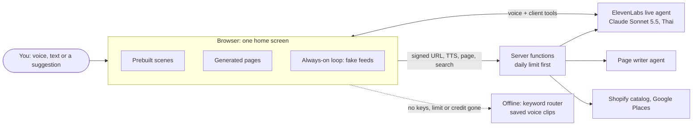

# Q-Bot, an Agent OS demo

**Talk to one agent instead of opening apps.** Q-Bot answers by voice and with
a full-screen UI that grows out of one home screen. When the task is done, the
UI folds back. Money moves only when you tap **Allow**.

U-Hackathon 2026 by U-topia. This README is for the judges first. The team's
notes start at [For the team](#for-the-team).

## Try it (judges)

**One click:** https://agents-os-dusky.vercel.app

Open it in Chrome on a laptop or a phone, then:

1. Tap the screen once to turn on sound. The mascot greets you in Thai.
2. Tap a suggestion, type in the box next to the mic, or hold the mic and
   speak (Thai or English). When Chrome asks for the microphone, allow it:
   the live agent needs it, even for typed requests. Without it, the page
   says "Offline mode" in one line at the top and keeps working offline
   (see below). While the agent thinks or searches, the mascot sways:
   - **"สัปดาห์นี้ยุ่งมาก"** ("this week is hectic"): the agent reads a
     shopping email and builds the list, then shows a payment card. Saying
     "pay" does not pay. Only a tap on **Allow** pays.
   - **"ช่วยทำ to-do list ให้หน่อย"** ("make me a to-do list"): there is no
     ready-made screen for this, so the agent draws a new page. It asks if
     you like it and changes the page when you answer.
   - **"นิ้วโดนมีดบาด เลือดไหลไม่หยุด"** ("I cut my finger, it keeps
     bleeding"): first-aid steps open at once, with a 1669 call button. The
     agent asks no questions.
3. Tap **⌂ Home** (or press `Esc`) to fold the screen back.
4. After you tap **Allow** and the payment folds back, stay on the home
   screen. A few seconds later the always-on agent speaks first about new
   sleep data and a race. The race sign-up fills itself, then waits for your
   yes or a tap on Submit. A few seconds after that the agent speaks about a
   flight delay: tap **Yes, change it** or **Keep**.

**Offline mode.** The live agent has a daily usage limit. When the limit is
reached, or the voice credit runs out, the page says so in one line at the
top. The same line shows when the microphone is not allowed. The page then
keeps working offline: keywords pick the screen, and the voice comes from
saved clips. All the suggestions above still work.

## What Q-Bot can do

| Ask for | What opens | Where the data comes from |
| --- | --- | --- |
| Shopping from an email ("สัปดาห์นี้ยุ่งมาก") | Shopping list, then a payment card | Demo data |
| A product ("หาหูฟัง งบ 1500") | Product cards from many Shopify shops | Shopify Global Catalog (real) |
| Training, a 10K race | Sleep score, run plan, race sign-up | Demo data |
| A flight | Delayed flight with a faster option | Demo data |
| Today, email to tasks ("สรุปวันนี้") | Secretary: tasks, appointments, notifications | Demo data ([notes](web/SECRETARY-DEMO.md)) |
| A place nearby ("หาร้านกาแฟแถวนี้") | Up to 5 places with distance and rating | Google Places (real, [notes](web/PLACES.md)) |
| A video or tutorial | A link to YouTube's search results | YouTube (real) |
| What it remembers ("จำอะไรไว้บ้าง") | Memory page: see, edit, forget | Your own browser |
| Anything else (to-do list, first aid, …) | A new page the agent draws | The agent |

## Run it yourself, with no keys

You need Node 20 or newer and Google Chrome.

```text
git clone https://github.com/phittayanan/hackathon-team.git
cd hackathon-team/web
npm install
npm start          # open http://localhost:5173
```

This is the offline mode described above. Nothing needs a key.

### With keys (the live agent)

Copy [.env.example](.env.example) to `.env` at the repo root and fill in:

| Key | With it | Without it |
| --- | --- | --- |
| `ELEVENLABS_API_KEY` | The brain is a live ElevenLabs agent (Claude Sonnet 5.5 inside, Thai voice and speech to text). It changes the screen only through client tools: it opens scenes, draws new pages and decides when to speak first | Keywords pick the screen, a to-do request gets one ready-made page, simple rules decide when to speak first |
| `ELEVENLABS_API_KEYS` | Several teammates' ElevenLabs keys, comma separated, used in order; one out of credit is skipped for the day ([Add an ElevenLabs account](docs/operations.md#add-an-elevenlabs-account)) | The single `ELEVENLABS_API_KEY` account only |
| `GOOGLE_MAPS_API_KEY` | Nearby places through Google Places API (New) | The places page says the key is not set |
| `SHOPIFY_AGENT_PROFILE_URL` | Product search uses our own agent profile | Product search uses Shopify's hosted example profile (fine for the demo) |
| `UPSTASH_REDIS_REST_URL` + `_TOKEN` | The daily limit is shared by every Vercel function instance (free Upstash Redis) | The limit is counted in memory: exact locally, best effort on Vercel |

Then run `cd web && npm run agent:sync` once. It creates the agents from
code (the live agent and the page writer), or updates them, in every
account. The server finds them by their names. Run `npm start` again.

## How it works



- **Browser** (`web/public/`): plain HTML and JS. The home screen has a
  mascot, a voice waveform, one subtitle line, suggestions and the mic with
  a text box. Each scene is a module in `web/public/js/scenes/` that fills
  its UI from data.
- **Brain**: an ElevenLabs agent defined as code (`web/agent/`). The browser
  joins it through a signed URL from the server. The agent can change the
  screen only through client tools (`web/public/js/agent-tools.js`): open a
  scene, act on it, draw, revise or inspect a generated page, mark a page
  urgent, keep a page, remember a fact, note a lesson, search videos, find
  places, and run secretary actions. When the code sees a mistake (a tool
  error, a failed layout check, the user turning a page down, the agent
  saying it cannot see what the user means), a silent note asks the agent to
  write one rule with `note_lesson` (`web/public/js/lessons.js`).
- **Generated pages**: the agent describes a page as JSON built only from
  fixed components (text, checklist, chart, steps, call button, …). The
  browser draws it with `textContent` only. With the agent's design brief, a
  second, text-only ElevenLabs agent, the page writer (`POST /api/page`),
  then writes the page as free HTML, which replaces the block page as it is
  written. Model HTML is sanitized before it is shown (no scripts, `on*`
  attributes, `javascript:` URLs, forms, iframes or outside loads except
  pictures), then shown in a shadow root. If the page looks broken, the
  block page stays. Pictures come from a fixed set in `web/public/pics/`.
  The page writer is told the page area (a phone screen, a 390 px frame on a
  laptop). Each version of a page is kept in the browser with its brief,
  look and colours: a revise sends the page writer the current look, and the
  agent can point at an earlier version ("the colours of the first one").
- **Server** (`web/server.js` locally, `web/api/` on Vercel, shared code in
  `web/lib/`): signed URL, text to speech, page writer, product and places
  search, the offline keyword router and the run log. Every route that
  spends credit checks the daily usage limit first.

## Safety rules

- **Allow is a button, never a word.** No tool can approve a payment. Saying
  "pay" or "allow" on the payment card only makes the Allow button pulse.
  The rules check (budget left, cap per payment, allowed shop) runs in code
  before the card shows.
- **Urgent requests come first.** Health or injury requests open first-aid
  steps at once. Serious cases get a 1669 call button. There is no "do you
  like it?" question, and the page is never saved.
- **One voice at a time.** A line waits for the one before it. While the
  live agent is connected, every line is said in its voice. Holding the mic
  silences the agent first, so it never hears itself.
- **No keys in the browser.** The ElevenLabs and Google keys stay on the
  server. The browser gets only a short-lived signed URL. Links are shown
  only when they are `http(s)`.
- **A limit on spending.** Daily limits apply to live sessions and to paid
  calls, for the whole site and per visitor. Then the page switches to
  offline mode by itself.

## What is fake

No real money, mail or bookings. Everything below is demo data in
`web/public/js/data.js`, `web/public/js/feeds.js` and
`web/public/js/secretary.js`:
- the shopping email from "Mom", the FreshMart Online prices, the payment
  card and the U-Card
- the delayed TG 102 flight and the faster FD 3433 option
- the sleep score, the run plan, the Bangkok City 10K sign-up and the
  runner "Ploy"
- the secretary's tasks, appointments and emails
- the feed events that make the agent speak first

Real: Shopify product results, Google Maps places and YouTube results. The
agent's answers are live when it runs with keys. Saved pages stay in your own
browser (`localStorage`). So does what the agent remembers about you (name,
likes, last task), what it learned from how you use it (for example "todo
pages: give items due dates", saved only when you asked for that change),
and up to five lessons it wrote after its own mistakes (for example "When
asked to make a page prettier, change only its look and keep its content").
Open the site with `?forget=1` to start clean.

## Repo map

```text
AGENTS.md          rules for every person and agent (start here if you work on the repo)
docs/              idea, decisions, workflow, operations, research; map in docs/README.md
web/               the app
  public/          browser: index.html, js/ (scenes/ is one file per scene), css/, voice/, pics/
  agent/           the live agent as code: prompt.md, knowledge.md, config.js
  lib/             server code shared by server.js and api/, with unit tests
  api/             Vercel functions
  scripts/         agent sync, voice render, lint, run log check, smoke and speed tests
  tests/           Playwright specs
.env.example       every key, what it does, and what happens without it
```

## For the team

Read [AGENTS.md](AGENTS.md) and [docs/workflow.md](docs/workflow.md) before
you work here. Deploy, agent sync, the run log and presenter controls are in
[docs/operations.md](docs/operations.md).

```text
cd web
npm run lint
npm test           # unit tests + Playwright in Chrome, with no API keys
```

Out of scope: real payments, real Gmail or calendar, LINE.
