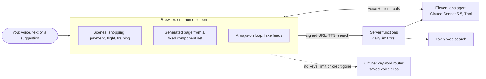

# Agent OS

**Talk to one agent instead of opening apps.** It answers by voice and with a
full-screen UI that grows out of one home screen. When the task is done, the
UI folds back. Money moves only when you tap **Allow**.

U-Hackathon 2026 by U-topia. This README is for the judges first. The team's
own notes come after the judges' part.

## Try it (judges)

**One click:** https://agents-os-dusky.vercel.app

Open it in Chrome on a laptop or a phone, then:

1. Tap the screen once to turn on sound. The mascot greets you in Thai.
2. Tap a suggestion, type in the box next to the mic, or hold the mic and
   speak (Thai or English). When Chrome asks for the microphone, allow it:
   the live agent needs it, even for typed requests. Without it, the page
   says "Offline mode" in one line at the top and keeps working offline
   (see below). While the agent thinks or searches, the mascot sways:
   - **"สัปดาห์นี้ยุ่งมาก"** ("this week is hectic"): the agent reads a
     shopping email and builds the list, then shows a payment card. Saying
     "pay" does not pay. Only a tap on **Allow** pays.
   - **"ช่วยทำ to-do list ให้หน่อย"** ("make me a to-do list"): there is no
     ready-made screen for this, so the agent draws a new page. It asks if
     you like it and changes the page when you answer.
   - **"นิ้วโดนมีดบาด เลือดไหลไม่หยุด"** ("I cut my finger, it keeps
     bleeding"): first-aid steps open at once, with a 1669 call button. The
     agent asks no questions.
   - **"หางานวิ่ง 10K ในกรุงเทพเดือนหน้าให้หน่อย"** ("find a 10K run in
     Bangkok next month"): the live agent searches the web and shows real
     results with their source links.
3. Tap **⌂ Home** (or press `Esc`) to fold the screen back.
4. After you tap **Allow** and the payment folds back, stay on the home
   screen. A few seconds later the always-on agent speaks first about new
   sleep data and a race, and fills in the race sign-up by itself. A few
   seconds after that it speaks about a flight delay: tap **Yes, change it**
   or **Keep**.

**Offline mode.** The live agent has a daily usage limit. When the limit is
reached, or the voice credit runs out, the page says so in one line at the
top. The same line shows when the microphone is not allowed. The page then
keeps working offline: keywords pick the screen, and the voice comes from
saved clips. All the suggestions above still work, except that
the web search becomes the ready-made training screen.

### Run it yourself, with no keys

You need Node 20 or newer and Google Chrome.

```text
git clone https://github.com/phittayanan/hackathon-team.git
cd hackathon-team/web
npm install
npm start          # open http://localhost:5173
```

This is the offline mode described above. Nothing needs a key.

### With keys (the live agent)

Copy [.env.example](.env.example) to `.env` at the repo root and fill in:

| Key | With it | Without it |
| --- | --- | --- |
| `ELEVENLABS_API_KEY` + `ELEVENLABS_AGENT_ID` | The brain is a live ElevenLabs agent (Claude Sonnet 5.5 inside, Thai voice and speech to text). It changes the screen only through client tools: it opens scenes, draws new pages and decides when to speak first | Keywords pick the screen, a to-do request gets one ready-made page, simple rules decide when to speak first |
| `ELEVENLABS_API_KEYS` | Several teammates' ElevenLabs keys, comma separated, used in order; one out of credit is skipped for the day (see [Add an ElevenLabs account](#add-an-elevenlabs-account)) | The single `ELEVENLABS_API_KEY` account only |
| `TAVILY_API_KEY` | The agent gets a `web_search` tool (Tavily, free tier, basic search). Results go on a generated page with source links | There is no search tool. Nothing else changes |
| `UPSTASH_REDIS_REST_URL` + `_TOKEN` | The daily limit is shared by every Vercel function instance (free Upstash Redis) | The limit is counted in memory: exact locally, best effort on Vercel |

Then run `cd web && npm run agent:sync` once. It creates the agent from
code, or updates it, in every account. The server finds it by its name.
Run `npm start` again.

## How it works



- **Browser** (`web/public/`): plain HTML and JS. The home screen has a
  mascot, a voice waveform, one subtitle line, suggestions and the mic with
  a text box. Each scene is a module that fills its UI from data.
- **Brain**: an ElevenLabs agent defined as code (`web/agent/`). The browser
  joins it through a signed URL from the server. The agent can change the
  screen only through client tools (`web/public/js/agent-tools.js`): open a
  scene, act on it, draw or revise a generated page, mark a page urgent,
  keep a page, or search the web.
- **Generated pages**: the agent describes a page as JSON built only from
  fixed components (text, checklist, chart, steps, call button, source
  links, …). The browser draws it with `textContent` only. With the agent's
  design brief, a fast page model (Gemini, `POST /api/page`) then writes the page
  as free HTML, which replaces the block page as it is written.
  Model HTML is sanitized before it is shown (no scripts, `on*` attributes,
  `javascript:` URLs, forms, iframes or outside loads except pictures), then
  shown in a shadow root. Scripts written by the model never run.
- **Server** (`web/server.js` locally, `web/api/` on Vercel): signed URL,
  text to speech, web search, the offline keyword router and the run log.
  Every route that spends credit checks the daily usage limit first.

## Safety rules

- **Allow is a button, never a word.** No tool can approve a payment. Saying
  "pay" or "allow" on the payment card only makes the Allow button pulse.
  The rules check (budget left, cap per payment, allowed shop) runs in code
  before the card shows.
- **Urgent requests come first.** Health or injury requests open first-aid
  steps at once. Serious cases get a 1669 call button. There is no "do you
  like it?" question, and the page is never saved.
- **One voice at a time.** A line waits for the one before it. While the
  live agent is connected, every line is said in its voice. Holding the mic
  silences the agent first, so it never hears itself.
- **No keys in the browser.** The ElevenLabs and Tavily keys stay on the
  server. The browser gets only a short-lived signed URL. Source links are
  shown only when they are `http(s)`.
- **A limit on spending.** Daily limits apply to live sessions and to paid
  calls, for the whole site and per visitor. Then the page switches to
  offline mode by itself.

## What is fake

No real money, mail or bookings. Everything below is demo data in
`web/public/js/data.js` and `web/public/js/feeds.js`:
- the shopping email from "Mom", the FreshMart Online prices, the payment
  card and the U-Card
- the delayed TG 102 flight and the faster FD 3433 option
- the sleep score, the run plan, the Bangkok City 10K sign-up and the
  runner "Ploy"
- the feed events that make the agent speak first

The web search results are real. The agent's answers are live when it runs
with keys. Saved pages stay in your own browser (`localStorage`). So does
what the agent remembers about you (name, likes, last task) and what it
learned from how you use it (for example "todo pages: give items due dates").
Open the site with `?forget=1` to start clean.

---

## For the team

Read [AGENTS.md](AGENTS.md) and [docs/workflow.md](docs/workflow.md) before
you work here. Storyboard: [docs/agent-os-storyboard.md](docs/agent-os-storyboard.md).

### Live agent checks

Create or update the live agent from code. The key needs the Agents
permission (scope `convai_write`). The `web_search` tool is synced only when
`TAVILY_API_KEY` is set:

```text
cd web
npm run agent:sync -- --dry-run   # show what would be sent
npm run agent:sync
```

The agent named `Agent OS (U-Hackathon 2026)` is the one judges use. To try an
agent change first, sync a test agent of your own (in the first account). It gets
new tools too, and its ids go to that file, never to `.env`. `ELEVENLABS_AGENT_ID`
pins it only with the single `ELEVENLABS_API_KEY`, not with `ELEVENLABS_API_KEYS`:

```text
npm run agent:sync -- --env ../.env.test-agent       # creates it the first time
ELEVENLABS_AGENT_ID=<id from .env.test-agent> PORT=5192 npm start
npm run smoke:live -- --base http://localhost:5192
```

Manual smoke test (Playwright covers only the no-key path and a stubbed
agent):
1. Run `npm start` and open http://localhost:5173 in Chrome.
2. Tap "สัปดาห์นี้ยุ่งมาก". `<body>` should show `data-brain="agent"`, the
   agent should answer in Thai, and the shopping list should open.
3. On the payment card, say "จ่ายเลย". It must not pay.

The browser's own speech recognition (Thai) needs Chrome on `localhost` or
HTTPS.

### Deploy on Vercel

The app deploys as static files (`web/public/`) plus small functions
(`web/api/`). The always-on agent runs in the page, so no server process is
needed. One-time steps for the captain:

1. Log in: `npx vercel login`.
2. Link the project: `cd web && npx vercel link`. The project's root
   directory is `web`, where `vercel.json` is.
3. Set the env vars for Production. Each command asks for the value:

   ```text
   npx vercel env add ELEVENLABS_API_KEYS production
   npx vercel env add TAVILY_API_KEY production
   npx vercel env add GEMINI_API_KEY production
   ```

   Use the same values as in `.env`. For an exact daily limit across
   function instances, add a free Upstash Redis database from the Vercel
   Marketplace. It sets `KV_REST_API_URL` and `KV_REST_API_TOKEN`. Change
   the limits with the `USAGE_*` variables in `.env.example`.
4. Deploy: `npx vercel --prod`.

### Add an ElevenLabs account

Each teammate's own account adds credit. To add one, put the key (it needs
the Agents permission) in the production list and redeploy, in `web/`:

```text
npx vercel env rm ELEVENLABS_API_KEYS production --yes
npx vercel env add ELEVENLABS_API_KEYS production   # paste every key, comma separated
npx vercel --prod
```

The production build runs `agent-sync --auto`: it finds the agent named
`Agent OS (U-Hackathon 2026)` in each account, creates it with its tools
if it is missing, and updates it otherwise. Preview and local builds never
sync. A failing account is a warning with its key masked, never a failed
deploy. The server finds each key's agent by the same name.

On Vercel, the run log goes to the function log: Vercel dashboard > the
project > Logs. Search for `[runlog]`.

### Run log: find what to fix

Each local server run writes one file, `web/logs/run-<time>.jsonl`. It stays
local and is never committed, because it holds what testers said. Each line
records one event with a millisecond time:
- what the user said, typed or tapped
- what the agent replied
- every tool call and web search
- every voice start and end, with its source
- scenes opening and closing
- feed events
- limit and offline switches
- errors

```text
cd web
npm run log:check                                   # the latest run
npm run log:check -- logs/run-2026-10-15T17-41-34-352Z.jsonl
```

It reports reply speed and flags:
- two voices at once
- replies slower than 3 s
- a scene that opened before the agent spoke
- a feed event pushed over speech
- self-hearing
- errors

To test the live agent end to end in Chrome, run
`npm run smoke:live -- --wav my-thai-request.wav`. The WAV is played as the
microphone.

To check speed in Chrome (first paint, time to ready, first tap to the agent's voice and scene,
warm reply), run `npm run measure -- --base <url> --runs 3`. Each live run uses one session of
the daily limit; `--offline` measures only the page load, and `--slow` simulates a phone on 4G.

### Presenter controls (team only)

Judges never need these. They work only when the page is opened with
`?presenter=1`.

| Control | What it does |
| --- | --- |
| `/` | Focus the text box |
| Tap the clock 3 times | Feed panel: sleep synced, flight delayed, new email, reset |
| `Shift+T`, `Shift+F`, `Shift+R` | Feed events: sleep synced, flight delayed, reset |
| `s`, `p`, `t`, `f`, `h` | Last resort: open shopping, payment, training or flight, or go home |

For everyone: hold `Space` or the mic to talk, and `Esc` folds back home.
Other URL options: `?script=off` stops the scripted feed events, and `?mute=1`
silences the voice.

### Test

```text
cd web
npm run lint
npm test           # unit tests + Playwright in Chrome, with no API keys
```

Out of scope: real payments, real Gmail or calendar, LINE.
