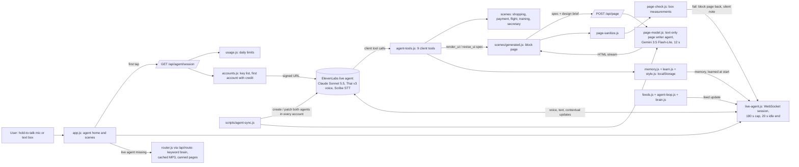

# Q-Bot agent architecture review

<!-- SUMMARY: written last, in part 3 -->

Date: 2026-10-16. Read from `main` at `31c0cfd` (after pull requests #43, #45, #46, #47, #48).
Code was read only: no test run, no ElevenLabs call, no key used.
Line numbers point at that commit.

## Part 1. The architecture as it is

| Part | What it does | Files |
| --- | --- | --- |
| Live agent | ElevenLabs agent, Claude Sonnet 5.5 inside, Thai `eleven_v3_conversational` voice, Scribe realtime speech to text, private (signed URL only). The browser joins over WebSocket with `@elevenlabs/client@1.26.0` from jsDelivr. | `web/agent/config.js:17-116`, `web/public/js/live-agent.js:1-16, 219-293` |
| Prompt and fact sheet | One system prompt (1,502 words) plus a fact sheet sent in full on every turn (`usage_mode: 'prompt'`, 518 words). Fills `{{today}}`, `{{memory}}`, `{{learned}}` at session start. | `web/agent/prompt.md`, `web/agent/knowledge.md`, `web/agent/config.js:53-89` |
| Client tools | 9 tools: `search_videos`, `secretary_action`, `open_scene`, `scene_action`, `render_ui`, `revise_ui`, `mark_urgent`, `keep_scene`, `remember`; plus the system tool `skip_turn`. Flat string params; structured data goes as a JSON string. Each waits for a reply, 10 s timeout; five force a spoken line first. Every result is a text string; a throw becomes `error: …`. | `web/public/js/agent-tools.js:36-117`, `web/agent/config.js:31-51, 91-98`, `web/public/js/live-agent.js:188-206` |
| Spec validator | `validateSpec` keeps known block types only, caps sizes, adds a 1669 button to serious pages; no usable block returns one fixed error string. | `web/public/js/genui.js:1-30, 53-118`, `web/public/js/agent-tools.js:143-144` |
| Page writer | Second, text-only ElevenLabs agent (Gemini 3.5 Flash-Lite, temperature 1, 8,192 max tokens). Server opens one chat-mode conversation per page, streams HTML back, 12 s limit; the key stays on the server. | `web/lib/page-model.js:1-18`, `web/agent/config.js:118-155`, `web/api/page.js` |
| Generated scene | Draws the block page at once, swaps in the streamed HTML in a shadow root after sanitizing it; taps reach the agent as `[scene event]`, hand edits as silent `[screen]` notes. | `web/public/js/scenes/generated.js:1-14`, `web/public/js/page-sanitize.js` |
| Page checker | Pure code on measured boxes after paint (overflow, overlap, tap size, missing text). A failure brings the block page back and tells the agent silently. No look check, no screenshot. | `web/public/js/page-check.js:1-20` |
| Offline brain | Keyword router on the server turns text into a scene and a line; brain rules decide when a feed change is worth speaking. Used whenever the live agent is not. | `web/lib/router.js:1-8`, `web/public/js/brain.js`, `web/api/route.js` |
| Always-on loop | Watches the feeds in the page; live, sends each change as a marked user message so the agent speaks or calls `skip_turn`. | `web/public/js/agent-loop.js:1-15`, `web/public/js/live-agent.js:318-320` |
| Memory and learning | A few facts (`remember` tool), the last task, up to 6 learned preferences and a style profile, all in `localStorage` on the phone; sent as dynamic variables at session start. | `web/public/js/memory.js`, `web/public/js/learn.js:1-5`, `web/public/js/style.js:1-8` |
| Screen context | At session start the agent gets the kept pages and the open page's summary as contextual updates; tool results carry a page summary. | `web/public/js/live-agent.js:279-284`, `web/public/js/scene-summary.js` |
| agent-sync | Creates or patches both agents, their tools and the fact sheet in every account, found by name; runs on each production deploy (`--auto`), never fails a deploy. | `web/scripts/agent-sync.js:1-20` |
| Server APIs | `/api/health`, `/api/agent/session` (signed URL), `/api/route`, `/api/tts`, `/api/page`, `/api/image`, `/api/catalog`, `/api/log`. Same handlers locally and on Vercel. | `web/lib/handlers.js`, `web/server.js:49-63`, `web/api/` |
| Usage limits | Per UTC day: 200 sessions for the site and 12 per visitor; 1,500 calls and 120 per visitor. Upstash Redis when set, else memory. Over the limit: `offline: 'limit'`. | `web/lib/usage.js:1-28` |
| Session limits | 180 s per session, 20 s idle end, enforced in the page and sent to ElevenLabs. | `web/public/js/session-limits.js:3-5`, `web/agent/config.js:105-110`, `web/public/js/live-agent.js:100-130` |
| Key fallback | `ELEVENLABS_API_KEYS`, one per teammate. The server uses the first account not marked empty; an "out of credit" answer (status 401/402/429 and a quota/credit word) marks it for the UTC day and tries the next. The page reports a live call cut for credit with `x-agentos-spent`. | `web/lib/accounts.js:1-9, 111-129`, `web/lib/tts.js:23-31`, `web/public/js/live-agent.js:78-89`, `web/lib/handlers.js:70-91` |
