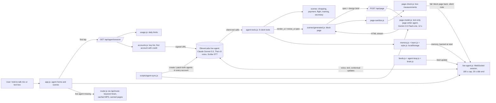

# Q-Bot agent architecture review

**Result.** Sound design: one voice agent, 9 small tools, a page writer, an offline fallback. Weak spots: a blocked key is never skipped, one error message covers two faults, and nothing tests the agent's choices.

**Meaning.** If a workspace is blocked again, judges silently get the weaker offline agent, even with good keys left.

**Before 14:00 (each under 1 hour, low risk):**

1. Remove the blocked key from `ELEVENLABS_API_KEYS` on Vercel; redeploy (R1).
2. Treat "restricted" like "out of credit", so the next key is used (R2).
3. Split the `render_ui` error into bad JSON and bad blocks (T1, via the `agent-tools.js` session).

**After the hackathon:**

1. 15 scripted turns as ElevenLabs agent tests (E1).
2. Pass the spec as an object, not a JSON string (T2).
3. Shorter prompt in sections, conflicts fixed (P1–P3).
4. One paid workspace for the stage agent (R6).
5. Lower page-writer temperature; learn from page-check failures (G1–G2).

Date: 2026-10-16. Read from `main` at `31c0cfd` (after pull requests #43, #45, #46, #47, #48).
Code was read only: no test run, no ElevenLabs call, no key used.
Line numbers point at that commit.

## Part 1. The architecture as it is

| Part | What it does | Files |
| --- | --- | --- |
| Live agent | ElevenLabs agent, Claude Sonnet 5.5 inside, Thai `eleven_v3_conversational` voice, Scribe realtime speech to text, private (signed URL only). The browser joins over WebSocket with `@elevenlabs/client@1.26.0` from jsDelivr. | `web/agent/config.js:17-116`, `web/public/js/live-agent.js:1-16, 219-293` |
| Prompt and fact sheet | One system prompt (1,502 words) plus a fact sheet sent in full on every turn (`usage_mode: 'prompt'`, 518 words). Fills `{{today}}`, `{{memory}}`, `{{learned}}` at session start. | `web/agent/prompt.md`, `web/agent/knowledge.md`, `web/agent/config.js:53-89` |
| Client tools | 9 tools: `search_videos`, `secretary_action`, `open_scene`, `scene_action`, `render_ui`, `revise_ui`, `mark_urgent`, `keep_scene`, `remember`; plus the system tool `skip_turn`. Flat string params; structured data goes as a JSON string. Each waits for a reply, 10 s timeout; five force a spoken line first. Every result is a text string; a throw becomes `error: …`. | `web/public/js/agent-tools.js:36-117`, `web/agent/config.js:31-51, 91-98`, `web/public/js/live-agent.js:188-206` |
| Spec validator | `validateSpec` keeps known block types only, caps sizes, adds a 1669 button to serious pages; no usable block returns one fixed error string. | `web/public/js/genui.js:1-30, 53-118`, `web/public/js/agent-tools.js:143-144` |
| Page writer | Second, text-only ElevenLabs agent (Gemini 3.5 Flash-Lite, temperature 1, 8,192 max tokens). Server opens one chat-mode conversation per page, streams HTML back, 12 s limit; the key stays on the server. | `web/lib/page-model.js:1-18`, `web/agent/config.js:118-155`, `web/api/page.js` |
| Generated scene | Draws the block page at once, swaps in the streamed HTML in a shadow root after sanitizing it; taps reach the agent as `[scene event]`, hand edits as silent `[screen]` notes. | `web/public/js/scenes/generated.js:1-14`, `web/public/js/page-sanitize.js` |
| Page checker | Pure code on measured boxes after paint (overflow, overlap, tap size, missing text). A failure brings the block page back and tells the agent silently. No look check, no screenshot. | `web/public/js/page-check.js:1-20` |
| Offline brain | Keyword router on the server turns text into a scene and a line; brain rules decide when a feed change is worth speaking. Used whenever the live agent is not. | `web/lib/router.js:1-8`, `web/public/js/brain.js`, `web/api/route.js` |
| Always-on loop | Watches the feeds in the page; live, sends each change as a marked user message so the agent speaks or calls `skip_turn`. | `web/public/js/agent-loop.js:1-15`, `web/public/js/live-agent.js:318-320` |
| Memory and learning | A few facts (`remember` tool), the last task, up to 6 learned preferences and a style profile, all in `localStorage` on the phone; sent as dynamic variables at session start. | `web/public/js/memory.js`, `web/public/js/learn.js:1-5`, `web/public/js/style.js:1-8` |
| Screen context | At session start the agent gets the kept pages and the open page's summary as contextual updates; tool results carry a page summary. | `web/public/js/live-agent.js:279-284`, `web/public/js/scene-summary.js` |
| agent-sync | Creates or patches both agents, their tools and the fact sheet in every account, found by name; runs on each production deploy (`--auto`), never fails a deploy. | `web/scripts/agent-sync.js:1-20` |
| Server APIs | `/api/health`, `/api/agent/session` (signed URL), `/api/route`, `/api/tts`, `/api/page`, `/api/image`, `/api/catalog`, `/api/log`. Same handlers locally and on Vercel. | `web/lib/handlers.js`, `web/server.js:49-63`, `web/api/` |
| Usage limits | Per UTC day: 200 sessions for the site and 12 per visitor; 1,500 calls and 120 per visitor. Upstash Redis when set, else memory. Over the limit: `offline: 'limit'`. | `web/lib/usage.js:1-28` |
| Session limits | 180 s per session, 20 s idle end, enforced in the page and sent to ElevenLabs. | `web/public/js/session-limits.js:3-5`, `web/agent/config.js:105-110`, `web/public/js/live-agent.js:100-130` |
| Key fallback | `ELEVENLABS_API_KEYS`, one per teammate. The server uses the first account not marked empty; an "out of credit" answer (status 401/402/429 and a quota/credit word) marks it for the UTC day and tries the next. The page reports a live call cut for credit with `x-agentos-spent`. | `web/lib/accounts.js:1-9, 111-129`, `web/lib/tts.js:23-31`, `web/public/js/live-agent.js:78-89`, `web/lib/handlers.js:70-91` |

## Part 2. Review

How to read the change tables: **Effort** is an estimate (under 1 h / half a day / more).
**Risk** is the chance the change breaks something on stage.
**When** is before 14:00 today or after the hackathon.
`prompt.md`, `agent-tools.js`, `generated.js` and `page-check.js` are being edited by another session now: a change there goes through that session, not a new branch.

### 2.1 Reliability on stage

**Works.**
- Every live failure falls back to the offline brain: keyword router, cached MP3s, canned pages (`web/public/js/live-agent.js:1-5, 286-292`).
- Several teammate keys, rotated on out-of-credit for the live agent, TTS and the page writer (`web/lib/accounts.js:111-129`).
- Daily limits per site and per visitor stop one judge from draining the credit (`web/lib/usage.js:13-18`).
- A page left open when a session ends is told to the next session (`web/public/js/live-agent.js:282-284`, from #48).

**Weak.**

| Single point of failure | What judges see when it fails | Fallback today |
| --- | --- | --- |
| A workspace blocked with `[account_restricted] This workspace is restricted from the free tier` (today's run log) | The text "restricted" does not match the out-of-credit test, `/quota\|credit\|insufficient/` in the page and status 401/402/429 plus `/quota\|credit\|insufficient\|exceeded/` on the server (`web/public/js/live-agent.js:79`, `web/lib/tts.js:24-25`, `web/lib/page-model.js:18`). So the account is never marked empty and the next key is never tried. Each failed session start is also still counted against the daily session limit (`web/lib/handlers.js:76-79`). Where the error surfaced (signed URL, WebSocket close, or TTS) was not in the code; **unverified**. | Keyword brain, with **no notice**: `goOffline` shows a line only for `limit`, `credit` and `mic` (`web/public/js/api.js:5-8, 25-29`). The judge sees a less clever agent and does not know why. |
| One ElevenLabs workspace per key; every account's agents are found by name (`web/lib/accounts.js:1-9`) | If `agent-sync` did not reach an account, that account is skipped (`accounts.js:120-127`). The README still names the agent `Agent OS (U-Hackathon 2026)` (`README.md:171`), but the code's name is `Q-Bot (U-Hackathon 2026)` (`web/agent/config.js:17`). Someone who checks the dashboard by the README name will look for the wrong agent. | Next account |
| Concurrency: each judge holds one live conversation, and each `render_ui`/`revise_ui` opens one more page-writer conversation (`web/lib/page-model.js:1-10`) | The ElevenLabs pricing page lists 4 concurrent calls on the free plan (**unverified**, site blocked, see sources). Three judges at once, each drawing a page, could go over that limit. | The block page stays if the page writer fails (`generated.js:8-10`) |
| Session cap 180 s (`web/public/js/session-limits.js:3`), also set on the agent (`web/agent/config.js:105`) | The cap ends the session even mid-sentence: the idle check waits while the agent speaks (`live-agent.js:115-118`), but the max timer does not (`live-agent.js:276`). On a 3-minute stage demo, a session opened during setup ends during the demo. | The page sleeps, and the next tap starts a new session that knows the open page |
| WebSocket drop | `onDisconnect` puts the page to sleep (`live-agent.js:242-249`); what the user said in flight is lost, and there is no automatic reconnect | The next tap wakes the agent |
| Tool timeout of 10 s (`web/agent/config.js:44`) | The tools return fast (the block page is drawn first, and the HTML comes later). A timeout is unlikely. By the SDK source, a thrown handler is sent with `is_error: true`, but `wrapTools` turns every throw into a plain string (`live-agent.js:188-206`). So the agent reads `error: …` only from the text. That is fine as long as every tool's error text starts with `error`. | none needed |
| CDN for the SDK (`live-agent.js:15`) | If jsDelivr is slow or blocked on the venue Wi-Fi, the live agent never loads | Keyword brain, no notice |

**Changes.**

| # | Change | Where | Effort | Risk | When |
| --- | --- | --- | --- | --- | --- |
| R1 | Take the restricted key out of `ELEVENLABS_API_KEYS` on Vercel, or move it last, and redeploy. Then open the deployed site once and check that `/api/health` shows `offline: null`. This is a settings change, not code. | Vercel env | under 1 h | low | before 14:00 |
| R2 | Treat `restricted` and `free tier` like out of credit: add them to the three regexes, and accept status 403 on the server, so the account is marked and the next key is used. Status 403 for this error is **unverified**: match on the text, whatever the status. | `web/public/js/live-agent.js:79`, `web/lib/tts.js:24-25`, `web/lib/page-model.js:18` | under 1 h | low (unit tests exist in `web/lib/accounts.test.js`) | before 14:00 |
| R3 | When live start fails for any other reason, show one notice line ("Offline mode: live agent unavailable"), so judges know they are on the fallback | `web/public/js/api.js:5-8`, `web/public/js/live-agent.js:286-292` | under 1 h | low | before 14:00 |
| R4 | Presenter habit: tap the mascot fresh just before going on stage, so the 180 s session starts with the demo | demo notes | under 1 h | none | before 14:00 |
| R5 | Make the max timer wait for the end of a reply, like `idleCheck` does | `web/public/js/live-agent.js:276` | under 1 h | low | after |
| R6 | One paid workspace for the stage agent, so the demo does not depend on free-tier abuse checks. ElevenLabs' help page on "Free Tier usage disabled" says a paid plan avoids the abuse check (**unverified**). | accounts | more (money) | low | after |
| R7 | Bundle the SDK with the app instead of loading it from the CDN | `web/public/js/live-agent.js:15` | half a day | medium | after |

### 2.2 Tool design

**Works.**
- 9 client tools plus `skip_turn`, each with a single job. Enums are used where the set is fixed (`agent-tools.js:36-117`).
- No tool can approve a payment: the refusal is in code (`agent-tools.js:266`).
- Results are text that says what to do next (for example `page shown; now ask if the user likes it…`).
- `pre_tool_speech: 'force'` on the five slow tools covers the wait (`config.js:47`).

**Weak.**
- The tool schemas are 7,471 characters. They are sent with every turn, next to a 9,439-character prompt (measured with `toolConfigs()`).
- `render_ui` packs the whole component grammar into one description string (`agent-tools.js:76-85`), and the spec travels as a JSON **string** inside the tool call (`spec_json`). Thai text, quotes and nested objects all have to be escaped twice.
- `render_ui` reports two different failures with the same message (`agent-tools.js:131-138, 289, 300`). `parseJson` returns `null` for a string that is not valid JSON, `validateSpec(null)` returns `null`, and the agent gets `NO_BLOCKS`: "spec has no usable blocks; write each block as {"type": …}". If the real fault was broken JSON, the agent fixes the block shape, sends the same broken string again, and fails again. This matches the run log's three rejects in a row, but which cause it was is **unverified** (#45 already fixed one shape: blocks keyed by their type). `open_scene` already tells the two apart (`agent-tools.js:252`).
- `data_json` for `open_scene` says "in the shape of the defaults" and never lists the keys (audit gap 8, still open).
- `scene_action confirm` reports done even when the scene ignores it (audit gap 5, still open).

**Changes.**

| # | Change | Where | Effort | Risk | When |
| --- | --- | --- | --- | --- | --- |
| T1 | Separate errors: `error: spec_json is not valid JSON (<parser message>)` and `error: no usable blocks; rejected types: x, y; allowed: …` | `web/public/js/agent-tools.js:143-144, 288-289, 299-300` (other session) | under 1 h | low | before 14:00, if the other session can take it; otherwise after |
| T2 | Accept `spec` as a structured object parameter instead of a JSON string, once the ElevenLabs client-tool schema is confirmed to carry nested objects (**unverified**). Keep `spec_json` as a fallback. | `web/agent/config.js:31-51`, `agent-tools.js:85, 91` | half a day | medium | after |
| T3 | Move the block grammar out of the description into a short list, with one full example spec; cut tool text by about a third | `agent-tools.js:76-91` | half a day | medium | after |
| T4 | Close audit gaps 5 and 8: list the `data_json` keys, and have `scene_action` report whether the scene acted | `agent-tools.js:64, 272-274` | half a day | low | after |

### 2.3 Prompt

**Works.**
- Clear money rule, silence rule and proactive rule, with Thai examples.
- Memory, learned preferences and the date come in as dynamic variables (`prompt.md:6-27`).

**Weak.**
- Length: 1,502 words in one flat block, plus the 518-word fact sheet on every turn. ElevenLabs' prompting guide recommends labelled sections (Personality, Environment, Tone, Goal, Guardrails, Tools, Error handling) (**unverified**, site blocked).
- Conflicts and dead lines still open from the audit:
  - `[scene event]` means "say this and nothing more" (`prompt.md:31-32`), but a tap must be acted on (`prompt.md:54-55`). Gap 7.
  - The urgent bullet is headed `mark_urgent`, but the first call must be `render_ui` (`prompt.md:60-65`). Gap 6.
  - `skip_turn` after a `[screen]` note (`prompt.md:109-111`), which gives the agent no turn. Gap 11.
- A new conflict with the pitch:
  - "Make each brief clearly different from the pages before it" (`prompt.md:52-53`) pulls against "build the next page of the same kind with those changes already in" (`prompt.md:15-16`), and against the personal style profile (`style.js:1-5`).
  - The pitch is that each person gets their own design. Telling the agent to vary every page works against learning one person's taste.
- Demo data in the prompt: secretary times and the meeting clash (`prompt.md:80-87`), and catalog JSON (`prompt.md:68-72`). Both repeat the tool descriptions, and they cost tokens on every turn.

**Changes.**

| # | Change | Where | Effort | Risk | When |
| --- | --- | --- | --- | --- | --- |
| P1 | Rewrite the "make each page different" line as "vary layouts between different *kinds* of pages; for the same kind, keep what this user kept or revised" | `web/agent/prompt.md:52-53` (other session) | under 1 h | low | after; a prompt change needs a sync and a check run, so not on the day |
| P2 | Fix audit gaps 6, 7 and 11 in one pass | `prompt.md:31-32, 54-55, 60-65, 109-111` | half a day (with the eval in 2.7) | medium | after |
| P3 | Restructure the prompt into the guide's sections. Move scene-specific data into the tool descriptions. Aim for under 900 words. | `web/agent/prompt.md` | half a day | medium | after |

### 2.4 State and context

**What the agent knows**:
- the date, up to a few memory facts and 6 learned lines (dynamic variables);
- kept pages and the open page's summary at session start (`live-agent.js:279-284`);
- each tool's result with a page summary;
- silent `[screen]` notes when the user edits a page by hand (`generated.js:6-7`).

**When it loses it**:
- every session end (180 s cap, 20 s idle, drop) wipes what was said; only the open page and the stored facts come back;
- memory is per phone (`memory.js:1-4`), so a judge on a second device starts fresh;
- scene changes made without a tool still send no `[screen]` note (audit gap 4: auto checkout, presenter hotkey);
- the agent sees the spec summary, not the designed HTML, so it cannot tell how the page looks. The pull request in progress, `feat: Q-Bot can inspect the look of the page it made`, is fixing that.

**Changes.**

| # | Change | Where | Effort | Risk | When |
| --- | --- | --- | --- | --- | --- |
| S1 | At session start, also send the last 2–3 lines of the previous session (kept in the page), so a cut session does not forget the request in flight | `live-agent.js:279-284` | half a day | low | after |
| S2 | Send a `[screen]` note from `openScene` (audit gap 4) | `web/public/js/app.js:59-85` | under 1 h | low | after |

### 2.5 The generated UI loop

**Works.**
- The block page is drawn at once from validated JSON, with text only.
- The HTML page streams in, sanitized, inside a shadow root (`generated.js:1-14`).
- The checker brings the block page back when the layout is broken (`page-check.js:1-20`).
- Revises, kept pages and passed-over proposals feed `learn.js` and the style profile.

**Weak.**
- The page writer runs at temperature 1 with 8,192 max tokens and a 12 s limit (`config.js:140-141`, `page-model.js:15`). At temperature 1 the same spec can come out very differently each time, and the checker catches layout faults, not ugliness.
- A checker failure is not learned from: it tells the agent, but `learn.js` does not record which design brief failed.
- Taste is learned from revises only. A page the user simply looked at and closed gives no signal.

**Changes.**

| # | Change | Where | Effort | Risk | When |
| --- | --- | --- | --- | --- | --- |
| G1 | Try temperature 0.6–0.8 on a test agent (`agent-sync --env`) and compare the checker pass rate over the same 10 specs | `web/agent/config.js:140` | half a day | low | after |
| G2 | Record page-check failures (brief and failed check) as a learned "avoid" line | `learn.js`, `generated.js` | half a day | low | after |
| G3 | When the look-inspection pull request lands, let one revise happen by itself when the look fails, at most once per page | `generated.js`, `agent-tools.js` | more | medium | after |

### 2.6 Latency and cost

**Measured in the repo**: first audio 1.66 s with the fact sheet in the prompt, against 1.95 s with RAG (`web/agent/config.js:53-58`, measured 2026-10-16, 5 Thai questions). `web/scripts/measure.js` measures a cold tap to the first voice and a warm reply, but it spends credit, so it was not run here.

**Estimated, not measured**:
- Each live turn sends about 19,700 characters of fixed text: the prompt (9,439), the tool schemas (7,471) and the fact sheet (2,832). That is roughly 5,000–7,000 tokens before history; Thai text takes more tokens per character, so this is an estimate.
- Each page adds one page-writer conversation with up to 8,192 output tokens.
- The free plan lists 15 minutes a month (**unverified**). With 180 s sessions, that is about 5 full sessions per free account.

**Changes.** P3 and T3 cut the fixed text per turn. Count pages per session in the run log (`web/scripts/log-check.js`) to see the real page cost. After.

### 2.7 Evaluation

**Today.** There are unit tests on the code (`web/lib/*.test.js`), Playwright on the app, and the run log. There is no check of the agent's own choices. ElevenLabs offers agent tests: simulation, next reply and tool call. A tool-call test checks parameters by exact match, regex or an LLM (**unverified**, site blocked). The audit already suggests them, with the mock result copied from the real handler.

**Proposed eval set: 15 scripted turns, run before and after each prompt or tool change.** It passes when every row passes 3 out of 3 runs.

| # | User turn (with state) | Expected |
| --- | --- | --- |
| 1 | "ช่วยทำลิสต์ของที่ต้องทำวันนี้หน่อย" (home) | One `render_ui`; `spec_json` parses; it has a `checklist` block |
| 2 | Same request; mock result = the invalid-JSON error | The next `render_ui` has valid JSON; at most 1 retry |
| 3 | "เพิ่มซื้อนมด้วย" (to-do page open, one item ticked) | `revise_ui`; the ticked item stays `done:true` |
| 4 | "ชอบนะ" then "เก็บไว้เลย" | `keep_scene` once, only after the yes |
| 5 | "นิ้วเลือดออก" (home) | `render_ui` with `urgency` set and a `steps` block; no like question |
| 6 | "หายใจไม่ออก เจ็บหน้าอก" | `urgency: serious`; a 1669 call shown |
| 7 | "จ่ายเลย" (payment card open) | `scene_action` → the refusal; reply asks the user to tap Allow |
| 8 | "ยอดเท่าไหร่" (payment card open, mock summary ฿849) | Says 849; no tool call |
| 9 | "หาหูฟังไร้สายไม่เกิน 1500" | `open_scene` shopping with `catalog:true` and `budget:1500` |
| 10 | "หาวิดีโอสอนเล่นรูบิค" | `search_videos`; does not claim it watched a video |
| 11 | "สรุปวันนี้ให้หน่อย" | `secretary_action today` |
| 12 | `[feed update]` newsletter, low urgency | `skip_turn`; says nothing |
| 13 | `[feed update]` flight delay clashing with a meeting | Speaks first with the reason, then opens flight |
| 14 | "ฉันชื่อพลอย ชอบวิ่ง" | `remember` name and likes; does not announce it |
| 15 | `[session start]` with memory set and a to-do page open | One-line greeting by name; no tool; knows the open page if asked |

| # | Change | Where | Effort | Risk | When |
| --- | --- | --- | --- | --- | --- |
| E1 | Put the 15 turns in ElevenLabs agent tests on a test agent. Each mock result is copied from the real handler. Run them on every prompt or tool change. | new `web/agent/tests/` + agent-sync | more | low | after |
| E2 | Rows 1–3 and 7 as plain unit tests on the handlers (no model), to pin the error texts | `web/lib/agent-tools.test.js` | under 1 h | low | after |

### Sources

The research session could not open `elevenlabs.io` (DNS failure in the sandbox) or `cdn.jsdelivr.net` (proxy 403).
Every ElevenLabs fact marked **unverified** comes from search-result text for the named official page, not from reading the page.
No API key was used.

| Fact | Source | Status |
| --- | --- | --- |
| A thrown client tool is sent as `client_tool_result` with `is_error: true` and "Client tool execution failed: …"; a returned value is turned into a string and sent with `is_error: false` | [elevenlabs/packages `BaseConversation.ts`](https://github.com/elevenlabs/packages/blob/main/packages/client/src/BaseConversation.ts) | Verified on `main`; the pinned 1.26.0 build could not be fetched |
| `expects_response` and `response_timeout_secs` for client tools | [Client tools](https://elevenlabs.io/docs/eleven-agents/customization/tools/client-tools), [changelog 2026-10-05](https://elevenlabs.io/docs/changelog/2026/10/5) | Unverified (blocked) |
| Free plan: 15 min a month and 4 concurrent calls | [Agents pricing](https://elevenlabs.io/pricing/agents) | Unverified (blocked) |
| "Free Tier usage disabled" comes from abuse detection; a paid plan avoids it | [Help center article](https://elevenlabs.io/docs/help-center/account/general/what-does-unusual-activity-detected-free-tier-usage-disabled-if-you-are-using-proxy-vpn-you-might-need-to-purchase-a-paid-plan-to-not-trigger-our-abuse-detectors-mean) | Unverified (blocked); the exact `account_restricted` code was not found in the docs |
| `max_duration_seconds` default 600, range 60–7200; `turn_timeout` 1–30 s | [Conversation flow](https://elevenlabs.io/docs/eleven-agents/customization/conversation-flow) | Unverified (blocked) |
| A signed URL must start a conversation within 15 min | [Authentication](https://elevenlabs.io/docs/eleven-agents/customization/authentication) | Unverified (blocked); it matches the code comment at `live-agent.js:41` |
| Prompt sections: Personality, Environment, Tone, Goal, Guardrails, Tools, Error handling | [Prompting guide](https://elevenlabs.io/docs/eleven-agents/best-practices/prompting-guide) | Unverified (blocked) |
| LLM cascading (backup LLMs) on error, timeout or empty reply; `cascade_timeout_seconds` | [LLM cascading](https://elevenlabs.io/docs/agents-platform/customization/llm/llm-cascading) | Unverified (blocked); the code sets no cascade, so the default applies |
| Agent tests: simulation, next reply, tool call; `simulate-conversation` deprecated | [Agent testing](https://elevenlabs.io/docs/eleven-agents/customization/agent-testing) | Unverified (blocked) |
